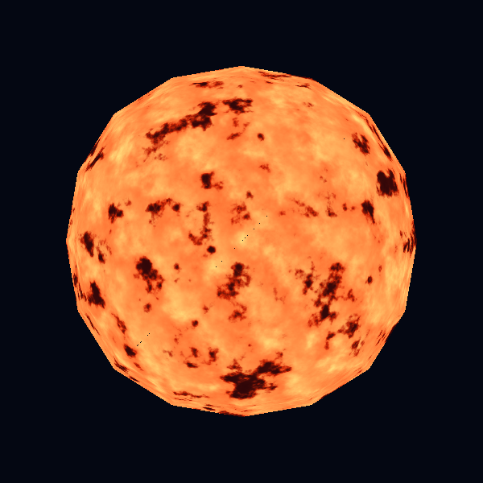
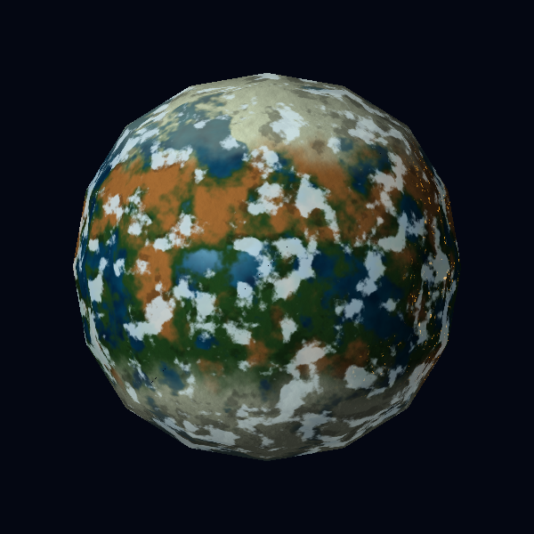
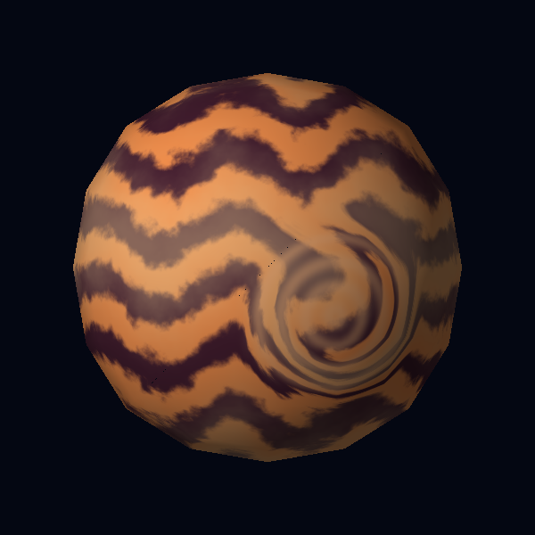

# Laboratorio 6: tres mundos procedurales

Una sola malla, `sphere.obj`, se rasteriza en CPU. El color de cada fragmento se calcula con funciones matemáticas; no se usan imágenes como texturas, modelos adicionales ni shaders de GPU. Raylib muestra el búfer RGBA y recibe el teclado. La cámara y la geometría permanecen inmóviles durante la animación.

## Requisitos y ejecución

- Rust con Cargo (edición 2024).
- Bibliotecas de sistema necesarias para compilar Raylib en Linux: CMake, compilador C y dependencias de X11/OpenGL. Se necesita una sesión gráfica para abrir la ventana.

```bash
cargo run --release
```

Teclas: `1` estrella, `2` rocoso, `3` gaseoso (también teclado numérico), `Espacio` pausa, `←/→` cambia la dirección de la luz, `S` guarda una captura PNG del cuerpo seleccionado, `Esc` sale. La estrella es emisiva y no cambia con la luz; el ángulo mostrado en pantalla sí se actualiza. La resolución es 600 × 600.

Para recrear las capturas incluidas sin abrir una ventana:

```bash
cargo run --release -- --capture
```

Para recrear videos, `--frames` genera secuencias PNG en `docs/frames/`; luego se pueden codificar con FFmpeg:

```bash
cargo run --release -- --frames
for nombre in estrella rocoso gaseoso luz; do
  ffmpeg -y -framerate 8 -i "docs/frames/$nombre/%03d.png" -c:v libx264 -pix_fmt yuv420p "docs/$nombre.mp4"
done
```

Los archivos fuente y las evidencias ya están en el repositorio. `docs/frames/` es temporal y puede eliminarse tras generar los videos.

## Diseños

| Cuerpo | Captura | Diseño y parámetros principales |
|---|---|---|
| **Ígnea**, estrella |  | Dos escalas de ruido (`p*6` y `p*19`) crean celdas calientes y grano fino. Una onda deformada por ruido genera filamentos. El umbral de `spot` (`0.31–0.43`) abre manchas oscuras; `heat` mezcla rojo, naranja y amarillo. No recibe luz externa. |
| **Nácar**, planeta rocoso |  | Un campo de ruido de baja frecuencia (`p*3.8`) separa océano y continente con umbral `0.48–0.57`; otro campo crea desiertos. La latitud y el ruido añaden casquetes polares. El océano tiene brillo especular (`powf(45)`), la tierra es mate. Ruido independiente en coordenadas giradas crea nubes sin otra esfera; `0.59–0.70` controla su cobertura y `t*0.14` su velocidad. |
| **Espiral**, gigante gaseoso |  | Ondas de latitud (`latitude*19`) producen bandas; ruido y una segunda onda ancha hacen ondular sus límites. Cerca de una posición fija, `influence` gira las coordenadas de muestreo antes de calcular las bandas: la tormenta curva la atmósfera alrededor. `0.16–0.58` controla el radio del vórtice y `2.3` su torsión. |

## Efectos por los que se solicitan puntos

| Efecto | Cuerpo y evidencia | Implementación | Cómo funciona y parámetro ajustable |
|---|---|---|---|
| Material animado | Ígnea: [video](docs/estrella.mp4) | `src/star.rs`, `shade` | El tiempo desplaza a velocidades distintas dos campos de ruido; `t*0.14` controla el movimiento de las celdas. La esfera queda fija. |
| Día y noche | Nácar: [video de luz](docs/luz.mp4) | `src/rocky.rs`, `shade` | La máscara `(1-smooth(0.02,0.26,l))` revela luces urbanas procedurales en tierra oscura; `0.26` cambia el ancho del crepúsculo. |
| Respuestas diferentes a la iluminación | Nácar: [video de luz](docs/luz.mp4) | `src/rocky.rs`, `shade` | El océano recibe un reflejo concentrado y la tierra sólo luz difusa; el exponente `45` cambia la concentración del reflejo. |
| Nubes procedurales | Nácar: [video](docs/rocoso.mp4) | `src/rocky.rs`, `shade` | Una máscara de ruido con cobertura ajustable se mezcla con el terreno. Sus coordenadas giran con `t*0.14`, mientras el campo de continentes no cambia. |
| Tormenta o vórtice localizado | Espiral: [video](docs/gaseoso.mp4) | `src/gas.rs`, `shade` | La distancia a `storm_center` determina cuánto giran las coordenadas antes de generar las bandas. El factor `2.3` modifica la torsión. |

La estrella y las bandas gaseosas también varían con el tiempo; para el criterio de material animado se usa únicamente el movimiento de las manchas de Ígnea, independiente de las nubes. Hay un oscurecimiento ligado a la máscara de nubes en Nácar, pero no se solicita puntaje por sombras de nubes.

## Pruebas

```bash
cargo test --offline
```

Las seis pruebas comprueban la validez de la malla compartida, la distinción entre shaders, la animación estelar, el rasterizador, la selección del cuerpo 3 y la respuesta de ambos planetas al cambio de luz. `--capture` también funciona sin pantalla y permite verificar visualmente la salida. La renderización usa píxeles y profundidad en CPU; el PNG se escribe con un codificador sin dependencias externas.

## Optimización y comprobación interactiva

El ruido usa un hash entero rápido, la dirección de luz se calcula una vez por cuadro y el rasterizador omite caras posteriores. Las teclas de selección se leen mientras están presionadas, para que el render no pierda pulsaciones breves; las flechas cambian la luz en pasos visibles. La ruta de teclado está cubierta por pruebas de selección y de iluminación. La ventana requiere un servidor gráfico; en un entorno sin acceso a pantalla se pueden verificar las imágenes y videos con los comandos anteriores.
